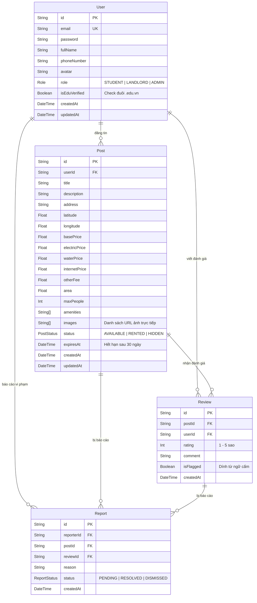

# CampusRent 🏠

Nền tảng web tìm kiếm và đánh giá phòng trọ sinh viên lấy các trường đại học làm tọa độ trung tâm.

---

## 📌 Tính năng nổi bật

1. **Lọc trọ theo bán kính thực tế:** Tìm phòng trong bán kính (1km, 3km, 5km) trực tiếp từ điểm chọn trên bản đồ hoặc vị trí hiện tại (sử dụng thuật toán Haversine).
2. **Bản đồ tương tác trực quan:** Giao diện chia đôi (Split View) đồng bộ giữa danh sách phòng và bản đồ Leaflet.
3. **Đánh giá minh bạch:** Cơ chế gắn badge *"Sinh viên đã xác thực"* cho các tài khoản đăng ký bằng email trường (`@*.edu.vn`) kèm bộ lọc từ ngữ thô tục.
4. **Dự toán chi phí sinh hoạt:** Tự động tính toán tổng tiền trọ dự kiến mỗi tháng dựa trên đơn giá điện, nước, internet và thói quen sử dụng thực tế.
5. **Tự động ẩn tin quá hạn:** Tích hợp tác vụ định kỳ (Cron Job) tự ẩn các bài đăng sau 30 ngày.

---

## 🛠 Công nghệ sử dụng (Tech Stack)

* **Frontend:** React 18, Vite, Tailwind CSS, Leaflet / React-Leaflet, Axios, React Router v6, Lucide Icons.
* **Backend:** Node.js (ES Modules), Express.js, Prisma ORM, JWT, Bcryptjs, Node-cron, Cloudinary SDK.
* **Database:** PostgreSQL (Supabase).

---

## 📁 Cấu trúc dự án

```text
CampusRent/
├── client/                 # Frontend React (Vite)
│   ├── public/             # Tài nguyên tĩnh
│   ├── src/
│   │   ├── api/            # Cấu hình Axios & API client
│   │   ├── components/     # UI components (Map, Room, Review)
│   │   ├── context/        # Auth Context
│   │   ├── hooks/          # Custom React Hooks
│   │   ├── pages/          # Các màn hình chính
│   │   └── routes/         # Điều hướng & bảo vệ route
│   └── .env.example
├── server/                 # Backend Node.js Express
│   ├── prisma/             # Schema CSDL & dữ liệu mẫu (Seed)
│   ├── src/
│   │   ├── config/         # Cấu hình Prisma, Cloudinary, JWT
│   │   ├── controllers/    # Bộ điều khiển xử lý logic request
│   │   ├── cron/           # Tác vụ tự động định kỳ
│   │   ├── middlewares/    # Middleware Auth, Upload, Error
│   │   ├── routes/         # Định tuyến RESTful API
│   │   └── services/       # Thuật toán Haversine, lọc từ cấm, tính chi phí
│   └── .env.example
├── CLAUDE.md               # Tài liệu đặc tả kỹ thuật chi tiết
└── README.md
```

---

## 🗄 Cấu trúc Cơ sở dữ liệu (Database Schema)

Dự án sử dụng PostgreSQL (Supabase) quản lý qua Prisma ORM tại `server/prisma/schema.prisma`:

### 1. Sơ đồ quan hệ thực thể (ERD)



### 2. Các bảng dữ liệu chính

| Bảng | Mô tả |
| :--- | :--- |
| **`User`** | Tài khoản người dùng phân quyền 3 Role (`STUDENT`, `LANDLORD`, `ADMIN`), trường `isEduVerified` tự động gán `true` khi đăng ký bằng email `@*.edu.vn`. |
| **`Post`** | Bài đăng phòng trọ: thông tin chi tiết, tọa độ GPS (Lat/Lng), giá thuê, định mức chi phí sinh hoạt (điện, nước, mạng, dịch vụ), tiện ích và mảng chứa URL hình ảnh (`images`). |
| **`Review`** | Đánh giá và bình luận bài đăng phòng trọ, tự động gắn cờ `isFlagged` nếu vi phạm từ khóa cấm. |
| **`Report`** | Báo cáo bài đăng ảo hoặc review xấu độc gửi lên Admin kiểm duyệt. |

---

## 🚀 Hướng dẫn cài đặt & Khởi chạy

### 1. Yêu cầu hệ thống
* Node.js >= 18.x
* Quản lý gói: `npm`

### 2. Cài đặt thư viện
Tại thư mục gốc, cài đặt dependencies cho cả Backend và Frontend:

```bash
# Cài đặt server
cd server
npm install

# Cài đặt client
cd ../client
npm install
```

### 3. Cấu hình biến môi trường

* **Server:** Tạo file `server/.env` từ file mẫu:
  ```bash
  cp server/.env.example server/.env
  ```
  Cập nhật chuỗi kết nối Supabase (`DATABASE_URL`, `DIRECT_URL`), khóa JWT và cấu hình Cloudinary.

* **Client:** Tạo file `client/.env` từ file mẫu:
  ```bash
  cp client/.env.example client/.env
  ```
  Mặc định: `VITE_API_BASE_URL="http://localhost:5000/api"`

### 4. Khởi tạo Cơ sở dữ liệu (Database)

Tại thư mục `server`:
```bash
# Đồng bộ Schema lên Supabase
npx prisma db push

# Nạp dữ liệu mẫu (30 phòng trọ thực tế kèm tài khoản mẫu)
npm run seed
```

### 5. Chạy ứng dụng

* **Khởi chạy Backend (Port 5000):**
  ```bash
  cd server
  npm run dev
  ```

* **Khởi chạy Frontend (Port 5173):**
  ```bash
  cd client
  npm run dev
  ```

Mở trình duyệt tại: `http://localhost:5173`

---