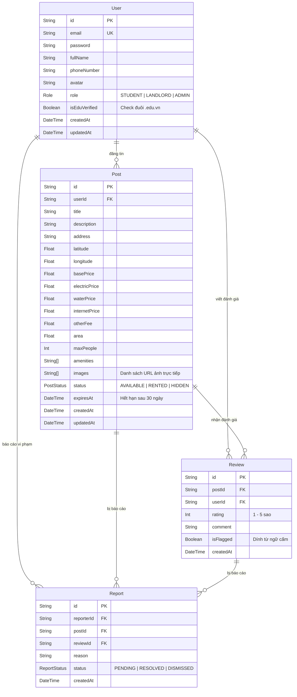

# CampusRent 🏠

Nền tảng web tìm kiếm và đánh giá phòng trọ sinh viên lấy các trường đại học làm tọa độ trung tâm.

---

## 📌 Tính năng nổi bật

1. **Lọc trọ theo bán kính thực tế:** Tìm phòng trong bán kính (1km, 3km, 5km) trực tiếp từ điểm chọn trên bản đồ hoặc vị trí hiện tại (sử dụng thuật toán Haversine).
2. **Bản đồ tương tác trực quan:** Giao diện chia đôi (Split View) đồng bộ giữa danh sách phòng và bản đồ Leaflet.
3. **Đánh giá minh bạch:** Cơ chế gắn badge *"Sinh viên đã xác thực"* cho các tài khoản đăng ký bằng email trường (`@*.edu.vn`) kèm bộ lọc từ ngữ thô tục.
4. **Dự toán chi phí sinh hoạt:** Tự động tính toán tổng tiền trọ dự kiến mỗi tháng dựa trên đơn giá điện, nước, internet và thói quen sử dụng thực tế.
5. **Tự động ẩn tin quá hạn:** Tích hợp tác vụ định kỳ (Cron Job) tự ẩn các bài đăng sau 30 ngày.

---

## 🛠 Công nghệ sử dụng (Tech Stack)

* **Kiến trúc:** ASP.NET Core MVC (.NET 8)
* **Giao diện (Views):** Razor Views (`.cshtml`), Bootstrap 5, jQuery, jQuery Validation
* **Cơ sở dữ liệu (Database & ORM):** PostgreSQL (Supabase / Local), Entity Framework Core (EF Core 8), Npgsql
* **Tiện ích & Bảo mật:** BCrypt.Net, CloudinaryDotNet

---

## 📁 Cấu trúc dự án

```text
CampusRent/
├── server/                     # Ứng dụng ASP.NET Core MVC (.NET 8)
│   ├── Controllers/            # HomeController, RoomsController, AccountController, AdminController
│   ├── Models/                 # Entities & ViewModels (User, Room, University, Review, Report, ErrorViewModel)
│   ├── Views/                  # Razor Views (.cshtml)
│   │   ├── Account/            # Login, Register
│   │   ├── Admin/              # Index (Quản trị duyệt báo cáo & thống kê)
│   │   ├── Home/               # Index (Trang chủ tìm kiếm trọ), Privacy
│   │   ├── Rooms/              # Index (Danh sách), Details (Chi tiết & Bảng tính sinh hoạt phí), Create
│   │   └── Shared/             # _Layout.cshtml (Bootstrap 5 + jQuery), _ViewStart, _ViewImports, Error
│   ├── wwwroot/                # Tài nguyên tĩnh
│   │   ├── lib/                # Bootstrap 5, jQuery, jQuery Validation
│   │   ├── css/                # site.css
│   │   └── js/                 # site.js
│   ├── Data/                   # CampusRentDbContext, DbSeeder
│   ├── Services/               # HaversineService, LivingCostService, ProfanityFilterService
│   ├── appsettings.json        # Chuỗi kết nối CSDL và cấu hình
│   ├── Program.cs              # Cấu hình MVC pipeline, UseStaticFiles, MapControllerRoute
│   └── CampusRent.Server.csproj
├── docs/                       # Tài liệu đặc tả hệ thống, sơ đồ UseCase, Activity, Class, DBML
├── CLAUDE.md                   # Tài liệu đặc tả kỹ thuật chi tiết
└── README.md
```

---

## 🗄 Cấu trúc Cơ sở dữ liệu (Database Schema)

Dự án sử dụng PostgreSQL (Supabase) quản lý qua Entity Framework Core (EF Core) tại `server/Data/CampusRentDbContext.cs`:

### 1. Sơ đồ quan hệ thực thể (ERD)



### 2. Các bảng dữ liệu chính

| Bảng | Mô tả |
| :--- | :--- |
| **`User`** | Tài khoản người dùng phân quyền 3 Role (`STUDENT`, `LANDLORD`, `ADMIN`), trường `isEduVerified` tự động gán `true` khi đăng ký bằng email `@*.edu.vn`. |
| **`Post`** | Bài đăng phòng trọ: thông tin chi tiết, tọa độ GPS (Lat/Lng), giá thuê, định mức chi phí sinh hoạt (điện, nước, mạng, dịch vụ), tiện ích và mảng chứa URL hình ảnh (`images`). |
| **`Review`** | Đánh giá và bình luận bài đăng phòng trọ, tự động gắn cờ `isFlagged` nếu vi phạm từ khóa cấm. |
| **`Report`** | Báo cáo bài đăng ảo hoặc review xấu độc gửi lên Admin kiểm duyệt. |

---

## 🚀 Hướng dẫn cài đặt & Khởi chạy

### 1. Yêu cầu hệ thống
* .NET SDK >= 8.0
* Node.js >= 18.x
* PostgreSQL (Local hoặc Supabase/Neon)

### 2. Cài đặt thư viện & dependencies
Tại thư mục gốc:

```bash
# Cài đặt client (Frontend)
cd client
npm install

# Khôi phục dependencies cho server (.NET Web API)
cd ../server
dotnet restore
```

### 3. Cấu hình biến môi trường

* **Server:** Cập nhật file `server/appsettings.json`:
  ```json
  {
    "ConnectionStrings": {
      "DefaultConnection": "Host=localhost;Port=5432;Database=campusrent;Username=postgres;Password=postgres"
    },
    "Jwt": {
      "Secret": "campusrent_super_secret_jwt_key_2026_at_least_32_characters_long",
      "Issuer": "CampusRent",
      "Audience": "CampusRentApp"
    },
    "Cloudinary": {
      "CloudName": "your_cloud_name",
      "ApiKey": "your_api_key",
      "ApiSecret": "your_api_secret"
    },
    "ClientUrl": "http://localhost:5173"
  }
  ```

* **Client:** Tạo file `client/.env` từ file mẫu:
  ```bash
  cp client/.env.example client/.env
  ```
  Mặc định: `VITE_API_BASE_URL="http://localhost:5000/api"`

### 4. Khởi tạo Cơ sở dữ liệu (Database)

Khi khởi động ứng dụng ASP.NET Core lần đầu, `DbSeeder` sẽ tự động khởi tạo bảng (`EnsureCreated`) và nạp sẵn 5 trường Đại học lớn tại Hà Nội kèm các tài khoản mẫu và phòng trọ thực tế.

### 5. Chạy ứng dụng

* **Khởi chạy Backend ASP.NET Core (Port 5000):**
  ```bash
  cd server
  dotnet run --urls="http://localhost:5000"
  ```
  Truy cập tài liệu Swagger UI tại: `http://localhost:5000/swagger`

* **Khởi chạy Frontend React (Port 5173):**
  ```bash
  cd client
  npm run dev
  ```

Mở trình duyệt tại: `http://localhost:5173`

---